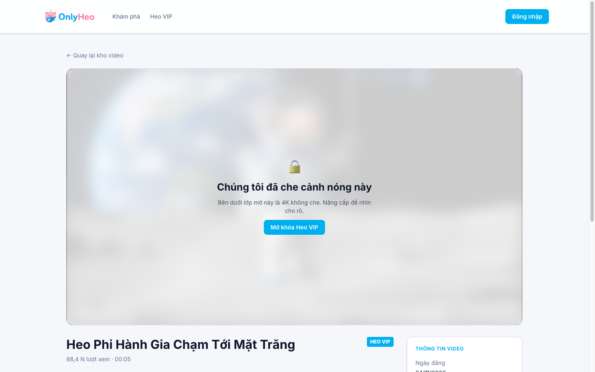
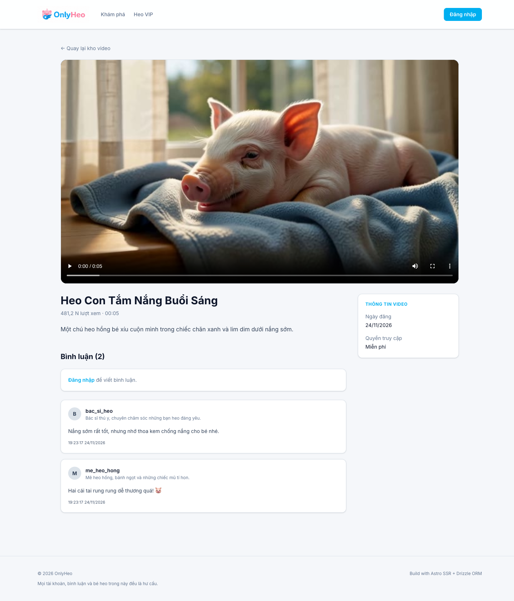
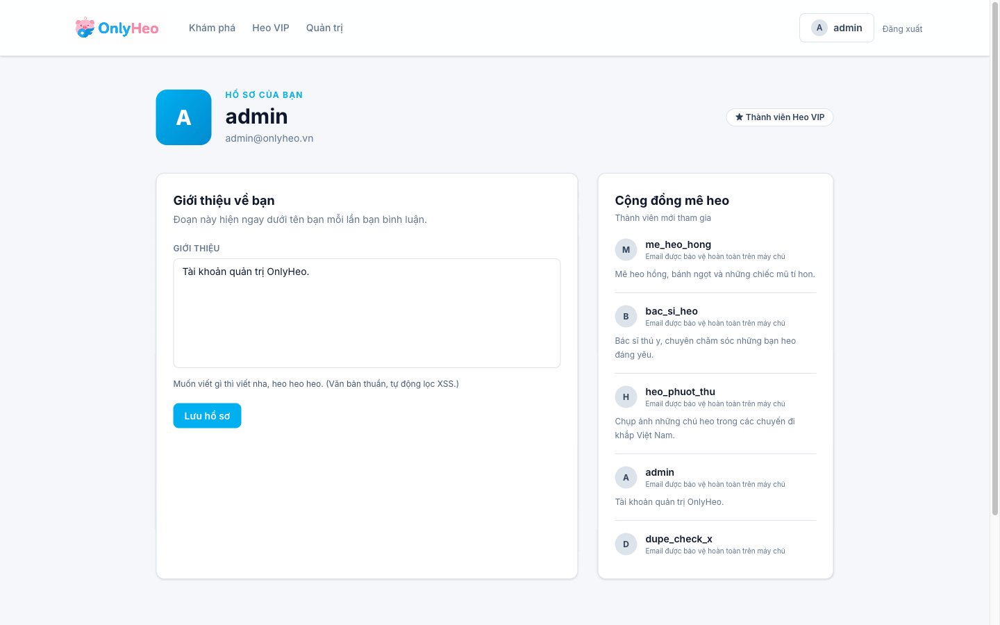
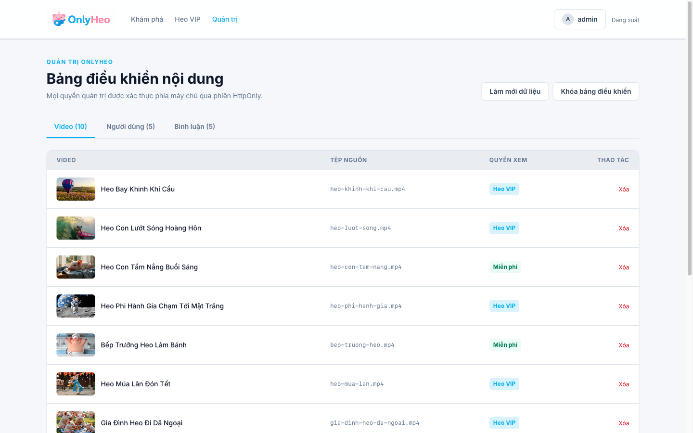

# OnlyHeo Secure — Astro SSR + Drizzle ORM + PostgreSQL

Phiên bản đã được vá bảo mật toàn diện của ứng dụng **OnlyHeo**, giữ nguyên giao diện và tính năng gốc nhưng chuyển sang kiến trúc **Astro SSR** kết hợp **Drizzle ORM** và **PostgreSQL cục bộ**.

Mọi quyết định phân quyền, truy vấn cơ sở dữ liệu, xác thực phiên, xử lý thanh toán và kiểm soát quyền truy cập video VIP đều được thực thi phía máy chủ — trình duyệt không bao giờ kết nối trực tiếp tới cơ sở dữ liệu hay nhận dữ liệu nhạy cảm.

## Ảnh chụp màn hình

### Trang chủ & thư viện video


### Cổng kiểm soát Heo VIP phía máy chủ
Video VIP không hề xuất hiện trong DOM khi chưa có quyền; endpoint `/api/videos/[id]/stream` trả về `403 Forbidden` cho người dùng chưa nâng cấp.


### Trình phát video & bình luận chống XSS


### Hồ sơ cá nhân & cộng đồng bảo vệ quyền riêng tư
Email của các thành viên khác không được truy vấn hay đưa vào DOM.


### Bảng điều khiển quản trị xác thực phía máy chủ


## Các vấn đề bảo mật đã được giải quyết

| Nhóm lỗi ở bản cũ | Cách giải quyết ở bản này |
| --- | --- |
| Trình duyệt gọi thẳng DB bằng anon key, tắt RLS | Mọi truy vấn đi qua Astro SSR + Drizzle ORM; trình duyệt không có quyền truy cập DB. |
| SQL Injection khi tìm kiếm (`search_videos_unsafe`) | Dùng truy vấn tham số hóa `ilike` của Drizzle và escape ký tự wildcard. |
| Đăng ký / xóa user qua RPC không kiểm tra quyền | Xử lý phía máy chủ với validation đầy đủ; xóa tài khoản chỉ cho phép admin (`locals.user.isAdmin`). |
| Băm mật khẩu yếu (`bcrypt` cost 6) & phiên trong `localStorage` | Băm mật khẩu bằng `crypto.scrypt` + salt ngẫu nhiên và `timingSafeEqual`; phiên lưu trong bảng `sessions` với cookie `HttpOnly; SameSite=Lax`. |
| Cổng VIP bằng CSS blur, lộ URL MP4 trong DOM & bucket công khai | Tệp MP4 lưu trong thư mục riêng tư `storage/videos/` (ngoài `public/`), stream qua `GET /api/videos/[id]/stream` có hỗ trợ `Range` và kiểm tra quyền VIP trên server. |
| Stored XSS qua `dangerouslySetInnerHTML` | Mọi bình luận và giới thiệu đều được Astro tự động escape thành văn bản thuần. |
| IDOR khi xóa bình luận | `POST /api/comments/[id]/delete` kiểm tra chủ sở hữu hoặc quyền quản trị trên server. |
| Hardcode mật khẩu admin, Stripe secret và ẩn dữ liệu bằng `.hidden-sensitive` | Đưa toàn bộ biến nhạy cảm vào `.env` (được gitignore); thanh toán xác thực phía máy chủ và ghi nhận giao dịch vào bảng `payments`. |
| Thiếu security headers & CSRF protection | Middleware thiết lập `Content-Security-Policy`, `X-Frame-Options: DENY`, `X-Content-Type-Options: nosniff`, `Referrer-Policy`, `Permissions-Policy` cùng `security.checkOrigin: true`. |

## Chạy cục bộ

### Yêu cầu

- Node.js `>= 22`
- Docker (để chạy PostgreSQL 16 cục bộ)

### Cài đặt & khởi chạy

1. Tạo tệp `.env` từ mẫu và điền các giá trị bí mật của bạn:

```bash
cp .env.example .env
```

2. Cài đặt dependencies:

```bash
npm install
```

3. Khởi động PostgreSQL cục bộ, đẩy schema Drizzle và nạp dữ liệu mẫu:

```bash
npm run db:up
npm run db:push
npm run db:seed
```

4. Chạy dev server:

```bash
npm run dev
```

Mở trình duyệt tại `http://localhost:4321`.

- Tài khoản quản trị mặc định dùng `SEED_ADMIN_EMAIL` và `SEED_ADMIN_PASSWORD` trong `.env`.
- Các tài khoản thành viên mẫu khác được tạo mật khẩu ngẫu nhiên khi seed; bạn có thể đăng ký tài khoản mới tại `/login?mode=register`.

## Cấu trúc dự án

```text
├── docker-compose.yml        # PostgreSQL 16 cục bộ (bind 127.0.0.1:5433)
├── drizzle.config.ts         # Cấu hình Drizzle Kit
├── .env.example              # Mẫu biến môi trường
├── public/                   # Logo, favicon và thumbnails công khai
├── storage/videos/           # Video MP4 riêng tư (chỉ phục vụ qua API có phân quyền)
├── scripts/seed.ts           # Script khởi tạo dữ liệu mẫu
└── src/
    ├── db/                   # Schema và kết nối Drizzle ORM
    ├── lib/                  # Auth session, scrypt password hashing, queries
    ├── middleware.ts         # Phiên đăng nhập & HTTP security headers
    ├── layouts/Layout.astro  # Bố cục chung
    ├── components/           # VideoCard.astro
    └── pages/                # Các trang SSR và API endpoints
```

## Lệnh thường dùng

| Lệnh | Mô tả |
| --- | --- |
| `npm run dev` | Chạy Astro dev server tại `localhost:4321` |
| `npm run build` | Build ứng dụng SSR vào `./dist/` |
| `npm run preview` | Xem trước bản build |
| `npm run db:up` | Khởi chạy PostgreSQL cục bộ bằng Docker Compose |
| `npm run db:push` | Đẩy schema Drizzle lên PostgreSQL |
| `npm run db:seed` | Xóa sạch và nạp lại dữ liệu mẫu |
| `npm run db:studio` | Mở Drizzle Studio |
